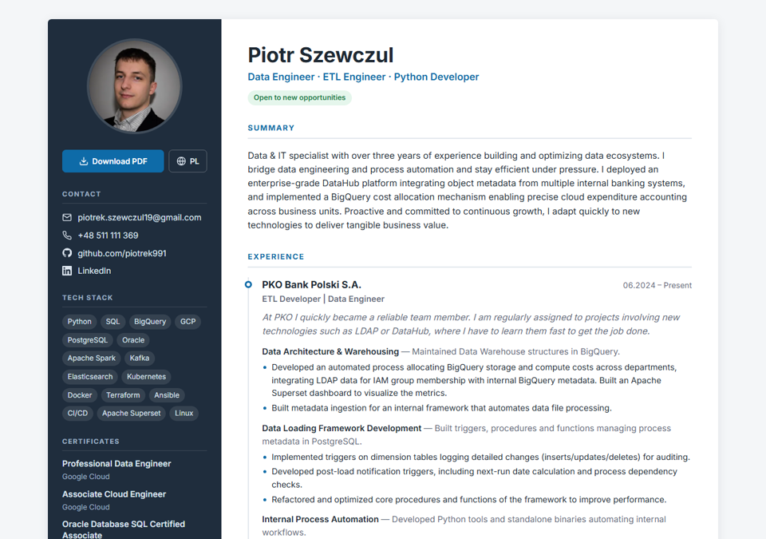

# Piotr Szewczul — CV

Bilingual (EN / PL) CV built with Jekyll and hosted on GitHub Pages.

- English: https://piotrek991.github.io/resume-template/
- Polish: https://piotrek991.github.io/resume-template/pl/
- PDF: `cv-en.pdf` / `cv-pl.pdf` (generated automatically on every deploy)



## Editing content

All content is plain YAML. There is no HTML in the data files. Each language has its own folder with the same structure:

| File | What it holds |
|---|---|
| `_data/<lang>/meta.yml` | Job title, summary, section labels, GDPR consent text |
| `_data/<lang>/experience.yml` | Jobs: `company`, `position`, `start`, `end`, `intro`, `tech[]`, `highlights[]` |
| `_data/<lang>/projects.yml` | Projects: `name`, `url`, `tech[]`, `description` |
| `_data/<lang>/skills.yml` | `core[]` (sidebar chips) + `categories[]` (detailed skills) |
| `_data/<lang>/education.yml` | `degree`, `school`, `years`, `bullets[]` |
| `_data/<lang>/certificates.yml` | `name`, `issuer`, `url` |
| `_data/<lang>/interests.yml` | Plain list |

Contact details, avatar and social links are in `_config.yml` under `author:`. They are shared by both languages.

When you add an entry, update both `en/` and `pl/`.

## Layout and styling

- `_layouts/resume.html` is the page skeleton. Each section lives in `_includes/` (`sidebar`, `experience`, `projects`, `skills`, `education`).
- `_sass/_resume.scss` holds all the styles. To change the colour scheme, edit the CSS variables in `:root`. The print/PDF styles are at the bottom of the file.

## Running locally

Requires Ruby 3.2+.

```sh
bundle install
bundle exec jekyll serve
# open http://localhost:4000/resume-template/
```

With Docker:

```sh
docker build -t cv .
docker run --rm -p 4000:4000 -v "$PWD":/home/app cv
```

## Deploying

Push to `gh-pages`. The workflow in `.github/workflows/jekyll.yml` does the rest:

1. Builds the site.
2. Renders `cv-en.pdf` and `cv-pl.pdf` with headless Chrome.
3. Publishes everything to GitHub Pages.

In the repo settings, set **Settings → Pages → Source** to **GitHub Actions**.

## License

Based on [jglovier/resume-template](https://github.com/jglovier/resume-template) (MIT). See [LICENSE](LICENSE).
